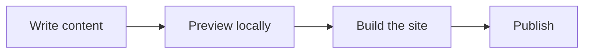

import SineWave from './article-enhancements/SineWave.astro';

This page brings together examples of Astro's built-in Markdown and MDX enhancements.

## Content organization

| Directory             | Purpose                                           |
| --------------------- | ------------------------------------------------- |
| `content/posts/`      | Articles                                          |
| `content/pages/`      | Standalone pages and builtin page introductions   |

Use a Markdown or MDX file for a simple entry. Create a folder with `index.md` or `index.mdx` when an article needs colocated images, components, or attachments. A post's `slug` sets its address; for example, `slug: demos` produces `/en/posts/demos/` with the default language-prefix policy.

Posts require a title and publication date. Other useful fields include a description, tags, and a cover image:

```yaml title="YAML"
title: An example article
slug: example
date: 2026-01-01
description: Introduce the article in one sentence.
tags: [astro, content]
image: ./cover.webp
featured: true
```

### Bundle images and attachments

Relative paths let you keep article assets beside the content. The cover and examples below are included as attachments in this post bundle.


Example attachments: [plain text](./file-samples/readme.txt), [Python code](./file-samples/example.py), [an HTML page](./file-samples/example.html), [a Markdown file](./file-samples/notes.md), and [an archive](./file-samples/example.zip).

## Article display options

Choose which article details to show globally in `article.display`, then override individual entries with the `display` frontmatter field.

| Field         | Displayed content                  |
| ------------- | ---------------------------------- |
| `title`       | Title, description |
| `author`      | Author                             |
| `published`   | Publication date                   |
| `updated`     | Last update                        |
| `tags`        | Tags at the bottom                 |
| `share`       | Share button and panel             |
| `navigation`  | Previous and next articles         |

All options are enabled by default. When `updated` is provided and differs from the publication date, the last update appears at the bottom of the article. To hide only the author on one entry, for example:

```yaml title="YAML"
display:
  author: false
```

Other fields inherit the global settings. Standalone pages support the same display options.

## Markdown and MDX enhancements

### Callouts

> [!NOTE]
> Callouts support **emphasis**, links, and `inline code`.

> [!WARNING] Check before publishing
> Preview the article and confirm that images and links open correctly.

Create a callout with markers such as `> [!NOTE]` or `> [!TIP]`. Add a custom title after the marker.

## Expressive Code blocks

```ts title="greeting.ts" {2,5}
type Reader = { name: string };
const reader: Reader = { name: 'BlogGPT' };

function greeting({ name }: Reader) {
  return `Hello, ${name}!`;
}
```

```sh title="Terminal"
pnpm check
pnpm build
```

### KaTeX math

Inline math such as $E=mc^2$ appears alongside text. Surround display math with `$$`:

$$
\int_0^1 x^2\,dx = \frac{1}{3}
$$

### Mermaid diagrams

Write a diagram in a code block marked `mermaid`:



### Image lightbox

Click an image to view it at full size. Zoom, switch images, or press Escape to close the lightbox.


### Interactive MDX components

Adjust the sine wave's amplitude, period, and initial phase with the sliders. Use arrow keys for smaller adjustments, or click Reset to restore the initial values.

<SineWave lang="en" />

Import an Astro component into an `.mdx` file, then place it in the body. This demo keeps the component and calculation helper under `article-enhancements/` in its bundle:

```mdx title="MDX"
import SineWave from './article-enhancements/SineWave.astro';

<SineWave lang="en" />
```

Keep one-off components in their article bundle, or write simple markup directly in MDX. Put components shared by multiple articles in `custom/components/` and import them using relative paths.

## Per-entry enhancement switches

Set global defaults for enhancements under `article` in `blog.config.ts`. Outlines use `toc.enabled`, and automatic share covers use `shareCover.enabled`. An article or standalone page can override only the fields it needs:

```yaml title="YAML"
math: true
mermaid: false
lightbox: true
callouts: true
toc: true
shareCover: false
```

`true` enables a feature, `false` disables it, and omitted fields inherit global settings. Available switches are `math` (KaTeX), `mermaid` (diagrams), `lightbox` (image zoom), `callouts`, `toc` (article outline), and `shareCover` (automatic social image). Disabling math, diagrams, or callouts displays their source or a plain quotation; disabling automatic share covers uses the configured article cover.

## Find an article

The homepage and search panel both find content. The default scope is “Articles”; “Titles” includes only article titles and descriptions, “Body” includes only article bodies, and “Everywhere” includes articles, tags and standalone pages.

Body matches include surrounding context. Click a passage to jump to the matching paragraph.

## Complete commands and articles

Type `/` to show matching commands, or `@` to complete titles from all public articles.

| Command       | Action                                                 |
| ------------- | ------------------------------------------------------ |
| `/random`     | Open a random recent public article                    |
| `/lang en`    | Switch the interface language                          |
| `/theme dark` | Change appearance; light and system are also available |
| `/status`     | Open blog statistics                                   |
| `/archives`   | Open the archives                                      |

## Keyboard shortcuts

| Shortcut                     | Action                   |
| ---------------------------- | ------------------------ |
| `Ctrl+K` / `⌘+K`             | Open search              |
| `Ctrl+Shift+S` / `⌘+Shift+S` | Toggle the sidebar       |
| `Ctrl+Shift+O` / `⌘+Shift+O` | Return home              |
| `Shift+Esc`                  | Focus the homepage input |
| `Ctrl+/` / `⌘+/`             | View keyboard shortcuts  |

Resize the sidebar by dragging its edge, or using arrow keys when the resize control is focused.

## Site statistics

Open statistics from the bottom-left author menu or by entering `/status` in the homepage input.


## Dates and publication states

| Setting                  | Publication behavior                                                   |
| ------------------------ | ---------------------------------------------------------------------- |
| Publication date reached | Published and included in lists and search                      |
| `draft: true`            | Saved as a draft for development preview                               |
| Future date              | Published when rebuilt after the date is reached                       |
| `hidden: true`           | Direct address remains available; omitted from lists and search |

`date` sets publication time, and `updated` sets the last update. Common date aliases are also supported for migration. See [Frontmatter](https://bloggpt.reincarnatey.net/en/content/frontmatter).

## Organize existing content

Place Markdown / MDX files in `content/posts/`, with images and attachments managed in bundles. Convert the previous system’s shortcodes and template tags to Markdown, HTML or MDX. Tags link through slugs. See [Content and feature examples](../demos/) for the file layout.

## Deploy and update

For automatic blog builds and deployments, connect a Git repository to Vercel (recommended):

1. Push the theme source to your own Git repository and import it into Vercel.
2. Select `Astro` for Framework Preset and keep Root Directory at the repository root.
3. Set Install Command to `pnpm install --frozen-lockfile`, Build Command to `pnpm build` and Output Directory to `dist`. Select Node.js `24.x` and add `ENABLE_EXPERIMENTAL_COREPACK=1` to the Production and Preview environment variables.
4. Set `site.baseUrl` to the production domain, commit the configuration and deploy. Later pushes to the production branch automatically rebuild and update the site; use other branches for previews.

`pnpm build` generates bundled attachments, share covers and Pagefind search indexes. Trigger another build when a scheduled article reaches its publication date. Other static hosts can also publish the complete `dist/` directory with directory indexes and a 404 page.

See [Build and deploy](https://bloggpt.reincarnatey.net/en/guide/deployment) for the full steps.
