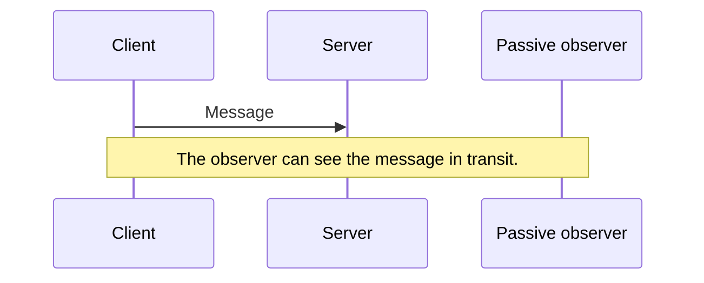
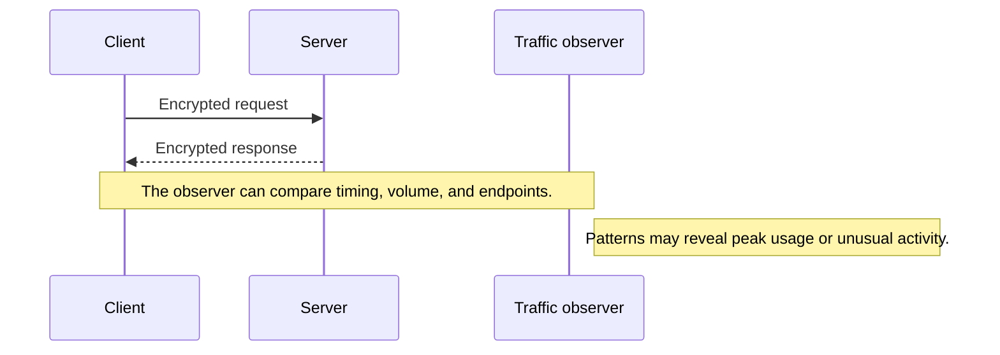
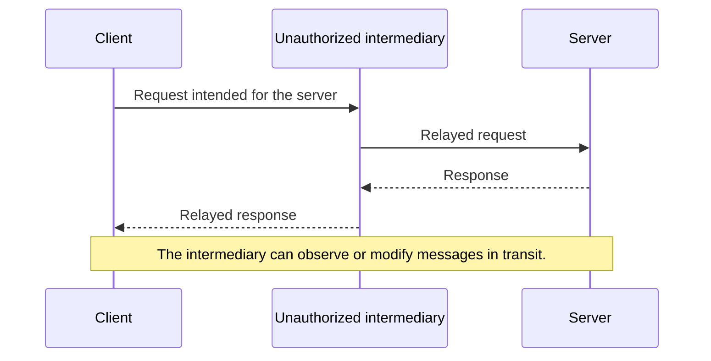
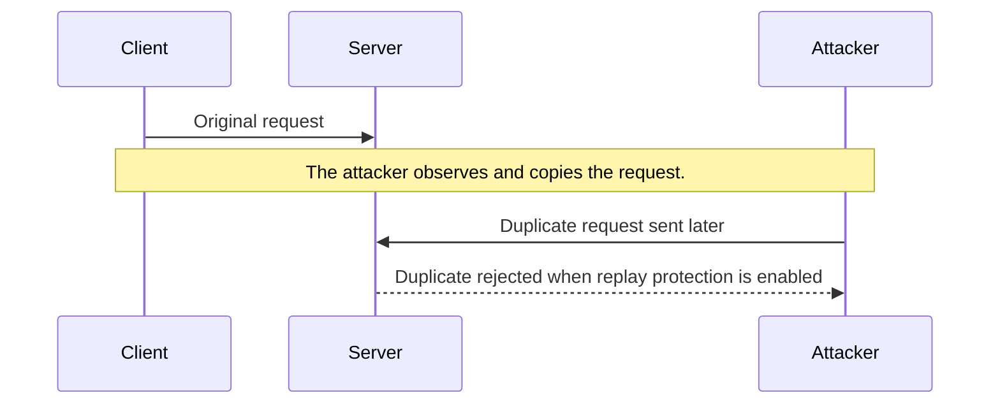

import MiniQuiz from '../../src/components/MiniQuiz.astro';

## Intro

We can divide cyber attacks into two types, **passive** and **active**.

- **Passive attacks** involve observing and collecting information without interfering with communication.
  - Passive eavesdropping
  - Traffic analysis
- **Active attacks** involve interfering with communication or disrupting a system's operation.
  - Active eavesdropping
  - Masquerade
  - Replay attacks
  - Denial of service

## Passive Attacks

**Passive eavesdropping** involves intercepting or monitoring communications without modifying or interrupting them.

An attacker who can observe unencrypted network traffic may see:

- Pages users visit
- Information sent in plain text
- Data submitted through forms
- Credentials transmitted without protection

**Traffic analysis** involves examining communication patterns to draw inferences. An attacker can draw conclusions from those patterns even when the contents of the messages are encrypted.

An attacker can observe:

- Peak traffic times
- Data volume
- Connection frequency
- Session duration
- Traffic sources and destinations

These patterns can suggest:

- Which server is used most often
- Whether maintenance is underway
- Whether a particular team is performing a task
- Whether activity on a given day is unusual

## Active Attacks

**Active eavesdropping** involves intercepting communications and potentially modifying their contents. A common example is a man-in-the-middle attack.

An attacker can:

- Intercept messages
- Modify transmitted information
- Redirect requests
- Insert content into the communication

A **masquerade attack** involves impersonating a legitimate user or device. The attacker acts as an authorized entity to gain unauthorized access or emit data under a false identity.

For example, if an attacker obtains an employee's credentials, they can use them to:

- Access internal systems
- Communicate on the employee's behalf
- Send fraudulent emails

A **replay attack** occurs when an attacker captures a legitimate message or request and later resends it to the same destination to try to repeat the original action.

Ways to reduce replay risk include:

- Validating message timestamps and rejecting stale requests
- Using single-use tokens
- Expiring sessions to limit the window for replay
- Rejecting duplicate transaction identifiers

A **denial-of-service (DoS)** attack disrupts a service or makes it unavailable to legitimate users.

An attacker may exhaust the service's resources or exploit a vulnerability to interrupt normal operation.

| DoS | DDoS |
| --- | --- |
| Denial of service | Distributed denial of service |
| Can originate from a single source | Originates from multiple sources |
| Aims to disrupt service availability | Aims to disrupt service availability |
| Can be carried out from a single machine | Often uses a botnet |

## Related Concepts

**Spoofing**: while a masquerade attack is a specific form of impersonation where an attacker acts as an authorized user, device, or system to gain unauthorized access or emit data under a false identity, Spoofing is a broad tactic of falsifying identity details (such as IP addresses, emails, or caller IDs) to deceive targets.

Examples of spoofing include:

- **IP spoofing** falsifies a packet's source IP address so that the packet appears to come from a different device.
- **ARP spoofing** uses forged ARP messages to associate one device's IP address with another device's MAC address. This can allow an attacker to intercept local network traffic.
- **Email spoofing** falsifies sender information so that an email appears to come from someone else.
- **DNS spoofing** manipulates DNS responses and can redirect a user to an IP address controlled by an attacker.

**Sniffing** is the practice of capturing and analyzing network packets. Wireshark is a well-known tool for packet capture and analysis. Network administrators can use sniffing to diagnose network problems.

A **man-in-the-middle attack** occurs when an attacker positions themselves between two communicating parties and intercepts their messages. The attacker can monitor, modify, or redirect those messages.

## Mini Test

Select one answer per question, then press **Confirm** at the bottom to check your answers. You can leave questions blank.

<MiniQuiz questions={[
  {
    prompt: 'What distinguishes a passive attack from an active attack?',
    choices: [
      'Passive attacks only affect wireless networks.',
      'Passive attacks observe communications. Active attacks interfere with communications or disrupt a system.',
      'Active attacks always come from multiple sources.',
      'Active attacks observe communications without altering them.',
    ],
    answer: 1,
  },
  {
    prompt: 'Someone reads unencrypted form submissions in transit without changing them. Which attack is this?',
    choices: ['Replay attack', 'Denial of service', 'Masquerade', 'Passive eavesdropping'],
    answer: 3,
  },
  {
    prompt: 'An observer notices a spike in encrypted traffic at the same time every day. What are they doing?',
    choices: ['Traffic analysis', 'Email spoofing', 'Replaying encrypted requests', 'Reading the encrypted messages'],
    answer: 0,
  },
  {
    prompt: 'A third party intercepts a request, changes it, and forwards it to the server. Which attack does this illustrate?',
    choices: ['Traffic analysis', 'Passive eavesdropping', 'Man-in-the-middle attack', 'Denial of service'],
    answer: 2,
  },
  {
    prompt: 'Someone signs in with another employee’s credentials and sends messages on their behalf. Which attack is this?',
    choices: ['Replay attack', 'Masquerade', 'Traffic analysis', 'Distributed denial of service'],
    answer: 1,
  },
  {
    prompt: 'An email appears to come from a colleague because its sender information was falsified. Which kind of spoofing is this?',
    choices: ['IP spoofing', 'ARP spoofing', 'DNS spoofing', 'Email spoofing'],
    answer: 3,
  },
  {
    prompt: 'An attacker deliberately resends a previously processed request to repeat the original action. Which attack is this?',
    choices: ['Replay attack', 'Passive eavesdropping', 'DNS spoofing', 'Denial of service'],
    answer: 0,
  },
  {
    prompt: 'How can transaction identifiers help a server reject replayed requests?',
    choices: [
      'By encrypting the network connection',
      'By extending the session each time a request arrives',
      'By rejecting requests with identifiers it has already processed',
      'By accepting every request with a valid identifier',
    ],
    answer: 2,
  },
  {
    prompt: 'What distinguishes a distributed denial-of-service attack from one launched from a single machine?',
    choices: [
      'It targets encrypted connections exclusively.',
      'It originates from multiple sources.',
      'It relies on impersonating a legitimate user.',
      'It requires the attacker to resend a valid request.',
    ],
    answer: 1,
  },
  {
    prompt: 'What is a legitimate reason for a network administrator to capture packets?',
    choices: [
      'To impersonate a colleague',
      'To redirect users to a fraudulent server',
      'To exhaust a server’s resources',
      'To diagnose a connection that keeps timing out',
    ],
    answer: 3,
  },
]} />
